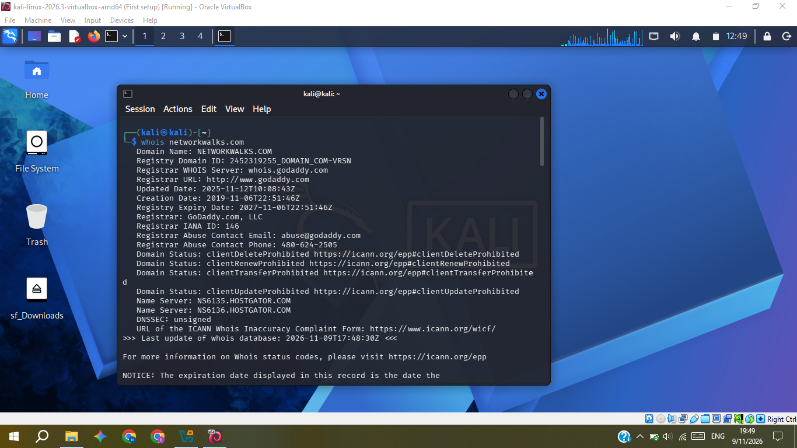
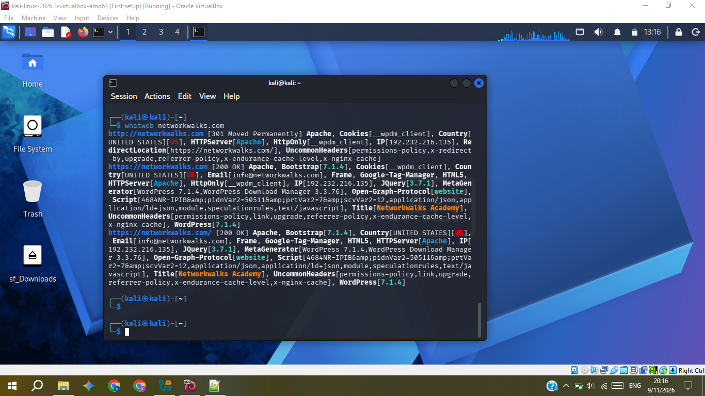
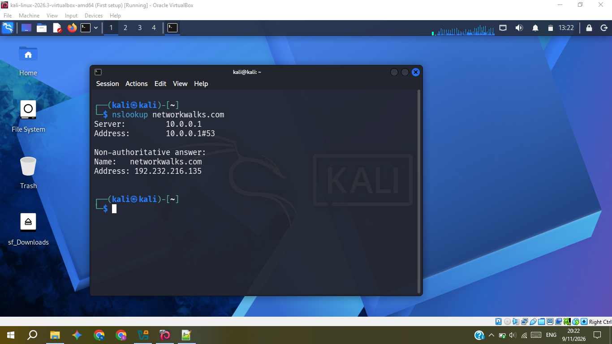
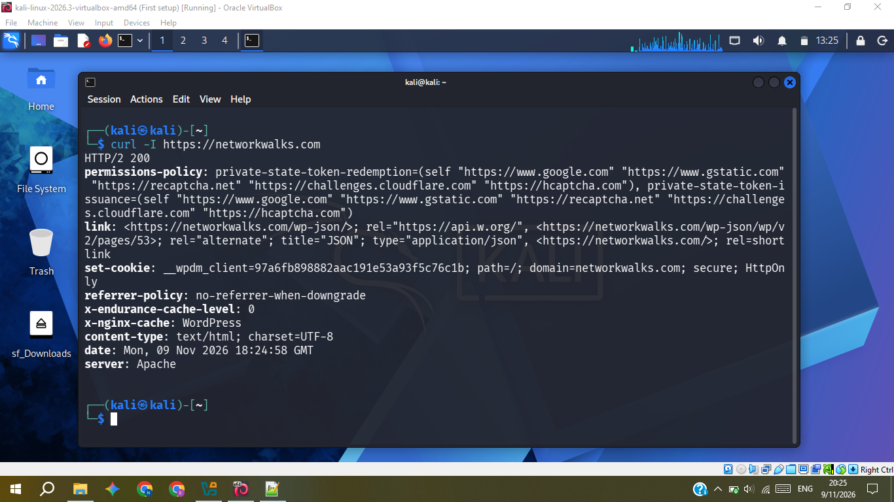
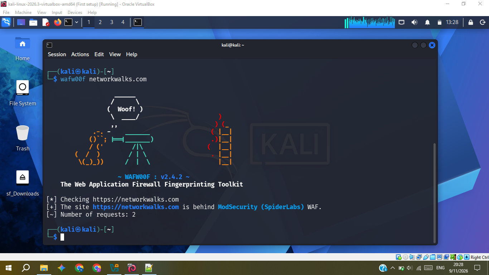
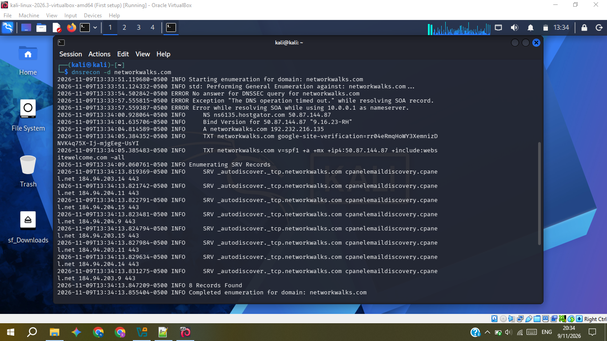
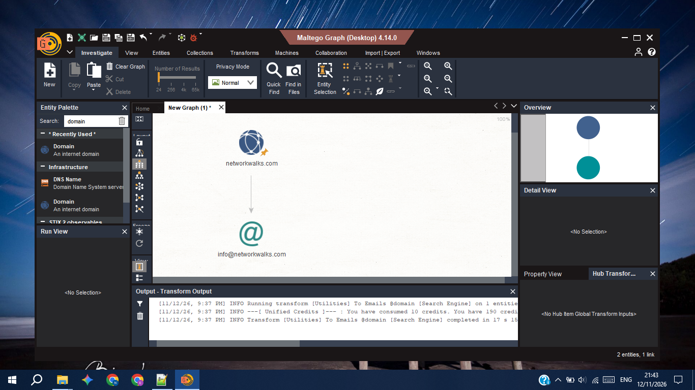
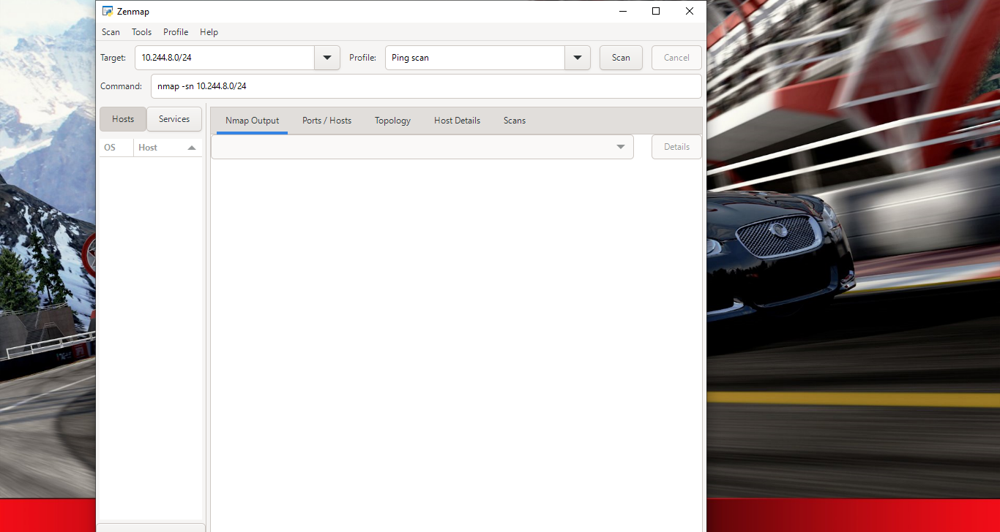

# RECONNAISSANCE, FOOTPRINTING AND NETWORK SCANNING REPORT
### Footprinting & Network Scanning Phases

**W2-PM-FINAL  |  CYBERSECURITY  |  NETWORKWALKS**

| Field | Detail |
|---|---|
| **Pentester Name (Cybersecurity Intern)** | **Enoch Muza** |
| **Program/Batch** | B084-Networkwalks |
| **Date** | 12 November 2026 |
| **Modules completed** | W2-PM1 (Multiple Kali Tools) W2-PM2 (GHDB) W2-PM3 (Maltego) W2-PM4 (theHarvester, not included in repo) W2-PM5 (Zenmap Scanning) |
| **Client/Target** | 1. Networkwalks (secured written permission already) 2. My own local LAN Network |
| **Permission secured from client?** | Yes |
| **Phases covered** | Reconnaissance & Footprinting,  Scanning & Network Discovery|

# 1. Liability Disclaimer

I have performed these activities only on the systems & devices where I had secured written permission or the devices/systems that I own myself. All these materials are for education and research purpose only. Do not use anything from here to break the law. The instructor, the authors and Networkwalks are not responsible for what you do with this knowledge. Every action you take is your own responsibility. Misuse can lead to criminal charges, heavy fines, loss of your job and a permanent record. In most countries unauthorised access is a crime even when nothing is damaged.

# 2. Introduction

This report covers footprinting the networkwalks.com domain using multiple Kali Linux tools (W2-PM1) and scanning my own local network with Zenmap (W2-PM5). The first 4 module covers the footprinting phase and the other covers the scanning phase, so together they show how an attacker moves from gathering public information to mapping live hosts on a network. It is the Week 2 part of my ongoing internship program at Networkwalks.

All commands were run in Kali Linux (footprinting) and on a Windows PC with Maltego(footprinting)&Zenmap installed (scanning). Every step below includes the exact command used, the result I observed, a screenshot as evidence, and a short note on why the finding matters from an attacker's point of view.

# 3. Tools Used

The table below lists each tool used in this report and its purpose. 

| Tool | Purpose |
|---|---|
| Kali Linux & Windows | Operating systems used for reconnaissance activities             |
| whois                | Find domain registration details (owner, dates, name servers).   |
| whatweb              | Fingerprint web technologies (server, CMS, plugins, IP).         |
| nslookup             | Resolve the domain name to its IP address using DNS.             |
| curl -I              | Read the HTTP response headers of the website.                   |
| wafw00f              | Detect whether a Web Application Firewall protects the site.     |
| dnsrecon             | Enumerate all DNS records (NS, MX, SPF, TXT, SRV).               |
| GHDB              | Find public exposed indexed links using Google dorks.    |
| Maltego              | Gathering OSINT and mapping digital relationships   |
| Zenmap (Nmap GUI)    | Scan the local subnet to find live hosts, IPs and MAC addresses. |
| Windows CMD          | Local IP and MAC address identification                          |

# 4. Activities Performed

## 4.1 Footprinting & Reconnaissance
All these project modules was done under the given permission of "networkwalks". The other PM2,PM3,PM4 were completed to see how other tools can be used for footprinting on publicly available information.

### 4.1.1 PM1 (Multiple Kali Tools)
whois - used it to identify the hosting provider of the "networkwalks.com" which is "HOSTGATOR"
 whatweb - used it to extract the software versions of the website such as WordPress 7.1.4,WordPress Download Manager 3.3.76
 nslookup - used to find the IP address of "networkwalks.com" which is 192.232.216.135
 curl -used it with -I parameter, to get only the response headers of the website without the website body
 wafw00f -  used it to check if the web application is protected by a firewall or not, "networkwalks" is secured by ModSecurity (SpiderLabs)
 dnsrecon - used to map out the DNS footprint of the email and hosting setup

### 4.1.2 PM2 (GHDB)

I used GHDB to footprint explosed public links to various IoT devices, such as live cameras, public files e.g. pdf listings. In which i tested some google dorks to find those links, where i found some live cameras using HTTP protocol and unencrypted, which raised a cause for concern for the owners of those cameras who don't realize their camera feed can be viewed by anyone on the internet just by a clever search on google without even knowing or touching their system. 

### 4.1.3 PM3 (Maltego)

I setup Maltego on Windows 10 PC, ignoring their minimum requirments. Used it to find related email adresses to "networkwalks.com", which resulted to only one email address, "info@networkwalks.com", i completed this task for the sake of exposure to see how other OSINT tools function

### 4.1.4 PM4 (theHarvester)

This one was ommitted in the documentation as the target website was not "networkwalks.com" and there was no clear permission for that website, but i completed its task to see how theHarvester commands works using the publicly available information from many search engines such as yahoo,baidu, on general public secure domains which has email hosting services. 

## 4.2 Network Scanning with Zenmap (PM5)

For this required tasks, i setup un Zenmap on windows. I then used ipconfig to check my local ip address and subnet of the network im connected to, in which case was the private wifi hotspot network, and my DHCP assigned IP address was  10.244.8.48 and the subnet 255.255.255.0
On the target section in zenmap, used 10.244.8.0/24, and used the ping scan option, which discovered up to 4 host devices on the network, with the following IP Addresses:

 10.244.8.214
 10.244.8.24
 10.244.8.150
 10.244.8.48 (host.docker.internal)->my pc
  
Which mapped the actual devices that are connected to that wifi hotspot, 4 real devices in total, the screenshot of the output results of zenmap, was not captured as it contained the physical MAC addresses of the real devices, not the Virtual Machines.
I exported the topology of the network of these devices, using the tology export, taking note of the legend to recognize what each symbol means.

# 5. Risk Analysis / Impact

Based on the information collected during the footprinting and network scanning activities, I identified the following potential risks.

| **\#** | **Risk / Finding**                           | **Evidence / Observation**                                  | **Potential Impact**                                                                                            | **Risk Level** |
|--------|----------------------------------------------|-------------------------------------------------------------|-----------------------------------------------------------------------------------------------------------------|----------------|
| 1      | Web technology information exposed           | WhatWeb identified WordPress and WP Download Manager        | Attackers may use exposed technology/version information to identify software requiring further security review | **● Medium**   |
| 2      | Server IP address identifiable               | Nslookup resolved the domain to `192.232.216.135`           | Provides information about the network location of the web service                                              | **● Low**      |
| 3      | HTTP technical information exposed           | Curl returned HTTP response headers and exposed `/wp-json/` | May assist technology fingerprinting and further enumeration                                                    | **● Low**      |
| 4      | WAF technology identifiable                  | Wafw00f identified ModSecurity (SpiderLabs)                 | Reveals information about the web application’s security architecture                                           | **● Low**      |
| 5      | DNS infrastructure information exposed       | DNSRecon identified DNS, mail and service-related records   | DNS information can help build a broader infrastructure profile                                                 | **● Medium**   |
| 6      | Multiple live hosts visible on local network | Zenmap identified four live hosts in the example network    | Unknown or unauthorized devices may potentially be present on a network                                         | **● Medium**   |

**Risk level key:** ● Critical ● Medium ● Low

The risks above are observations from the footprinting and scanning exercises, not confirmed vulnerabilities.

The practical exercises primarily involved information gathering and host discovery. No exploitation or vulnerability validation was performed as part of these modules.

Therefore, the presence of information such as a software version, IP address or DNS record does not by itself mean that the system is vulnerable. Further authorized security testing would be required to confirm any actual vulnerability.

# 6. Recommendations

Based on the observations from these activities, I recommend the following security improvements:

1.  **Review publicly exposed technology information**  
    Organizations should regularly review what information about their web technologies, CMS and plugins is publicly visible.

2.  **Keep software updated**  
    CMS platforms, plugins and other web technologies should be regularly updated and reviewed against current security advisories.

3.  **Review HTTP headers**  
    HTTP response headers should be reviewed to determine whether unnecessary technical information is being exposed.

4.  **Review DNS records regularly**  
    DNS records should be checked periodically to ensure that only required information and services are publicly exposed.

5.  **Properly configure and monitor the WAF**  
    Keep the WAF (ModSecurity) enabled and tuned, since it already blocks naive attacks.

6.  **Perform regular internal network discovery**  
    Organizations should periodically scan their own networks to identify active devices.

7.  **Investigate unknown devices**  
    Any unexpected device discovered during network scanning should be investigated and verified.

8.  **Maintain network documentation**  
    Network topology and device information should be documented and updated regularly.

9.  **Perform security testing with authorization**  
    Reconnaissance and scanning should only be performed against systems and networks where appropriate authorization has been provided.

# 7. Conclusion

During Week 2 of my Cybersecurity internship, I completed practical activities covering footprinting, reconnaissance and network scanning.

I used various tools for passive reconnaissance to inspect the information that is publicly available on given domain, No actual direct attack to that domain was done, except the network scanning of my local area network, which helps to identify unauthorised devices on the network. 

Each project module tools had its own strengths and weaknesses, choosing the right tools can be crucial in being up to date with the security of  a domain, and knowing what your website exposes publicly can help take measures to defend against attacks. I also learned that all findings should be clearly documented so they can be cross referenced and used for further analysis, if the owner of a website uses that report to fix the vulnerabilities of their system, they can rerun those tests to see if the risk to their system is minimised.

Finally, I learned that reconnaissance and scanning must always be performed within an authorized scope. These activities were completed as part of the assigned educational cybersecurity lab.

# 8. Evidences Collected

*Screenshots and output collected as evidence during the activities (stored in the each `PM{number}/` folder):*

## PM1 (Multiple Kali Tools)

### PM3 (Maltego)

## PM5 (Zenmap)

-End-
